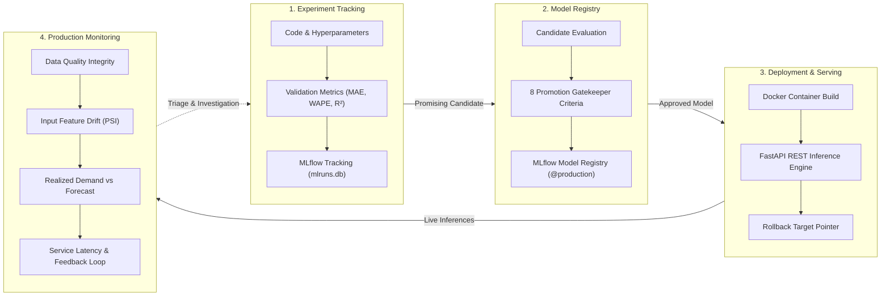

# Operational MLOps Lifecycle & Monitoring Architecture — MORROW

> "A little ahead of demand."

This document establishes the operational MLOps foundation for MORROW, defining the distinction between the four core lifecycle phases, explaining the automated promotion and rollback mechanisms, detailing the Population Stability Index (PSI) drift methodology, and clarifying the crucial domain principle: **drift is an investigation trigger, not an automatic retraining command.**

---

## 🏛 The Four Pillars of the ML Lifecycle

In production retail forecasting, mixing up development exploration with production governance creates silent model regressions, out-of-stock crises, and unmaintainable pipelines. MORROW enforces strict subsystem boundaries between the four pillars:



| Lifecycle Pillar | Core Objective | Key Questions Answered | Primary Tooling | MORROW Implementation |
|---|---|---|---|---|
| **1. Experiment Tracking** | Record and compare exploratory training iterations across algorithms, feature sets, and hyperparameters. | *"What parameters produced this validation WAPE?" "Did expanding rolling windows improve $R^2$?"* | MLflow Tracking, Weights & Biases | `backend/ml/train.py`, `mlruns.db` |
| **2. Model Registry** | Central catalog for vetted model artifacts, versions, metadata, and formal promotion approvals. | *"Which exact model version is approved for production?" "Who approved it and against what criteria?"* | MLflow Model Registry, DVC | `backend/ml/promotion.py`, `backend/models/model_metadata.json` |
| **3. Deployment** | Package approved artifacts into isolated runtime containers and serve low-latency inference endpoints with rollback safety. | *"How do services request forecasts?" "Can we rollback in under 1 second if a model faults?"* | Docker, FastAPI, Uvicorn, Gunicorn | `backend/app/main.py`, `backend/Dockerfile`, `backend/ml/rollback.py` |
| **4. Production Monitoring** | Continuously observe operational data quality, feature distributions, realized accuracy, and API service health. | *"Did transaction schemas change?" "Has customer buying behavior shifted?" "Are latency SLAs held?"* | Prometheus, Grafana, Custom PSI Monitors | `backend/ml/monitoring/`, `/api/monitoring/*` |

---

## 🚦 Automated Promotion Criteria & Guardrails

To prevent post-hoc bias, MORROW's model promotion thresholds are explicitly defined in [params.yaml](file:///Users/mahajanpiyush/Desktop/Work/projects/MORROW/params.yaml) before training. A candidate model cannot enter production without passing all **8 automated gates**:

| Gate ID | Criterion | Threshold | Actual (Candidate) | Justification |
|---|---|---|---|---|
| **GATE_01** | Overall Test WAPE | $\le 0.90$ | **0.8321** | Aggregate forecast error must remain bounded to avoid excessive working capital misallocations. |
| **GATE_02** | Seasonal Baseline Lift | $\ge +5.0\%$ | **+16.36% lift** | Candidate must decisively beat standard retail rule of thumb (Lag-7) to justify ML system complexity. |
| **GATE_03** | Explained Variance ($R^2$) | $\ge +0.05$ | **+0.1589** | Guarantees the model captures actual demand variation rather than fitting a naive flat mean. |
| **GATE_04** | High-Volume Guardrail | WAPE $\le 0.85$ | **0.7384** | Fast-moving SKUs drive $>50\%$ of catalog revenue; large errors here directly impact cash flow. |
| **GATE_05** | Mid-Volume Guardrail | WAPE $\le 0.95$ | **0.8506** | Protects intermediate volume products from margin erosion. |
| **GATE_06** | Low-Volume Guardrail | WAPE $\le 1.40$ | **1.2469** | Accounts for zero-sales days in slow movers while bounding catastrophic over-forecasting. |
| **GATE_07** | Data Quality Audit | 0 Critical Issues | **0 Issues** | Corrupted or duplicate transaction records must never be allowed to train an active production model. |
| **GATE_08** | Calibrated Interval Coverage | $\ge 70.0\%$ | **75.8% coverage** | Validates that the 80% nominal uncertainty interval provides mathematically verified coverage on held-out test data. |

### Promotion & Registration Flow:
```bash
python3 backend/ml/promotion.py
# Or via API
curl -X POST http://localhost:8000/api/model/promote
```
1. Reads test evaluation metrics and data quality outputs.
2. Evaluates the 8 gates.
3. If passed:
   - Registers new version under `morrow_demand_forecasting_model` in MLflow Model Registry.
   - Sets alias `@production` and `@champion`.
   - Backs up pre-existing model to `backend/models/archived/` as a rollback target.
   - Updates `backend/models/model_metadata.json`.
4. If failed:
   - Tags run as `REJECTED` in MLflow with failed gate IDs. Production remains on the existing approved model.

---

## 🔄 Instant Model Rollback Path

If a newly deployed model exhibits anomalies post-deployment (e.g., runtime latency spikes or erroneous batch predictions), the operator can execute a single-command rollback:

```bash
python3 backend/ml/rollback.py
# Or via API
curl -X POST http://localhost:8000/api/model/rollback?reason="Elevated+realized+prediction+error"
```

### Rollback Mechanics:
1. **Target Identification:** Locates the latest verified archive in `backend/models/archived/`.
2. **Inference Sanity Check:** Executes an end-to-end synthetic prediction check on the candidate backup artifact before touching production.
3. **Quarantine:** Moves the failing active model into `backend/models/quarantined/` with a UTC timestamp for offline post-mortem debugging.
4. **Restoration:** Restores the archived `.joblib` model into `backend/models/random_forest_demand.joblib`.
5. **Registry Synchronization:** Reverts the MLflow `@production` alias to the previous version and updates `model_metadata.json`.

---

## 📈 Input Feature Drift (PSI) & Retraining Philosophy

### 1. Population Stability Index (PSI) Formulation
MORROW calculates PSI to monitor distribution shifts between the baseline validation dataset ($E$) and recent production inference batches ($A$):

$$\text{PSI} = \sum_{b=1}^{B} \left( A_b - E_b \right) \times \ln\left( \frac{A_b}{E_b} \right)$$

Where:
* $B = 10$ quantile bins established on the baseline distribution.
* $E_b$ is the proportion of validation observations in bin $b$.
* $A_b$ is the proportion of production inference observations in bin $b$.
* $\epsilon = 10^{-4}$ smoothing prevents division-by-zero or $\ln(0)$ distortions.

### 2. Thresholds & Limitations
* $\text{PSI} < 0.10$: **Stable** — Negligible distribution movement; normal operations.
* $0.10 \le \text{PSI} < 0.25$: **Moderate Shift** — Meaningful movement; logged for ongoing tracking.
* $\text{PSI} \ge 0.25$: **Significant Drift** — Substantial distribution shift; triggers operational investigation.

> [!WARNING]
> **Limitations of PSI:**
> - PSI evaluates marginal 1D distributions independently; it does not capture higher-order feature interactions.
> - PSI is sensitive to binning strategies (e.g. heavily zero-inflated retail series require quantile smoothing).
> - PSI measures *input shift*, NOT *model accuracy*.

### 3. Crucial Retraining Philosophy: Drift as an Investigation Trigger
> [!IMPORTANT]
> **Drift does NOT automatically mean retraining is required.**
> 
> In retail environments, input features frequently drift due to benign, anticipated operational changes:
> 1. **Calendar Seasonality:** Entering Q4 holiday shopping naturally shifts `lag_1` and `rolling_mean_28` higher.
> 2. **Promotional Campaigns:** Temporary price discounts shift `unit_price` distributions.
> 3. **Catalog Expansions:** Introduction of new complementary lines.
> 
> **Blindly triggering automated retraining on drift alone is hazardous:**
> - A model trained on pre-holiday steady-state data may still predict holiday elasticities accurately if features captured the lift correctly.
> - Retraining on a small, noisy initial spike can overfit to transient noise and compromise post-holiday forecasts.
> 
> **MORROW's Triage Workflow:**
> 1. **Trigger Alert:** High PSI generates an `INVESTIGATION_TRIGGER` alert.
> 2. **Context Validation:** Merchandising confirms whether holiday, marketing, or macro events caused the shift.
> 3. **Residual Check:** Check realized residuals (WAPE/MAE) on the drifted SKUs via `/api/monitoring/performance`.
> 4. **Retrain Decision:** Retraining is triggered *only* when input drift is accompanied by downstream forecast accuracy deterioration.

---

## 🛡 Production Monitoring & Feedback Loop

### 1. Data Quality Checks (`GET /api/monitoring/data-quality`)
* **Missing Dates:** Verifies continuous daily grid coverage across modeled SKUs.
* **Duplicates:** Detects duplicate transaction or aggregated SKU-Date records.
* **Invalid Quantities:** Identifies negative quantities or unexpected zero-sales records.
* **Volume Spikes:** Flags single-day sales exceeding $5\times \text{IQR}$ over SKU median for commercial verification.

### 2. Performance Tracking (`GET /api/monitoring/performance`)
* Evaluates realized WAPE, MAE, and RMSE against observed actual demand across 7, 14, and 30-day rolling windows.
* Computes **Forecast Bias (Tracking Signal)** to detect systematic over-forecasting (holding cost risk) or under-forecasting (stockout risk).

### 3. Service Monitoring (`GET /api/monitoring/service`)
* Tracks HTTP request volume and status breakdown (2xx, 4xx, 5xx).
* Measures API latency percentiles: mean, p50, p95, p99.
* Monitors model loading duration and memory footprint.

### 4. Operational Alerts (`GET /api/monitoring/alerts`)
Every alert contains structured, actionable fields:
```json
{
  "alertId": "ALT-DRIFT-HIGH-001",
  "category": "feature_drift",
  "severity": "WARNING",
  "whatChanged": "Significant distribution shift (PSI >= 0.25) observed in feature(s): rolling_mean_28.",
  "affectedEntities": ["feature:rolling_mean_28", "model:v1.2.0"],
  "recommendedAction": "INVESTIGATION TRIGGER ONLY — DO NOT automatically trigger retraining. Verify whether shift aligns with Q4 retail seasonality. Validate realized forecast residuals before deciding on retraining.",
  "status": "INVESTIGATING"
}
```

### 5. Persistent Feedback Log (`/api/monitoring/feedback`)
Stored in append-only JSONL format at `backend/data/feedback/forecast_feedback.jsonl`:
* Records forecast timestamp, model version, SKU, recommended order quantity, assumed stock, realized actual demand, and stockout outcomes.
* Closes the operational loop between machine learning recommendations and physical warehouse outcomes.
